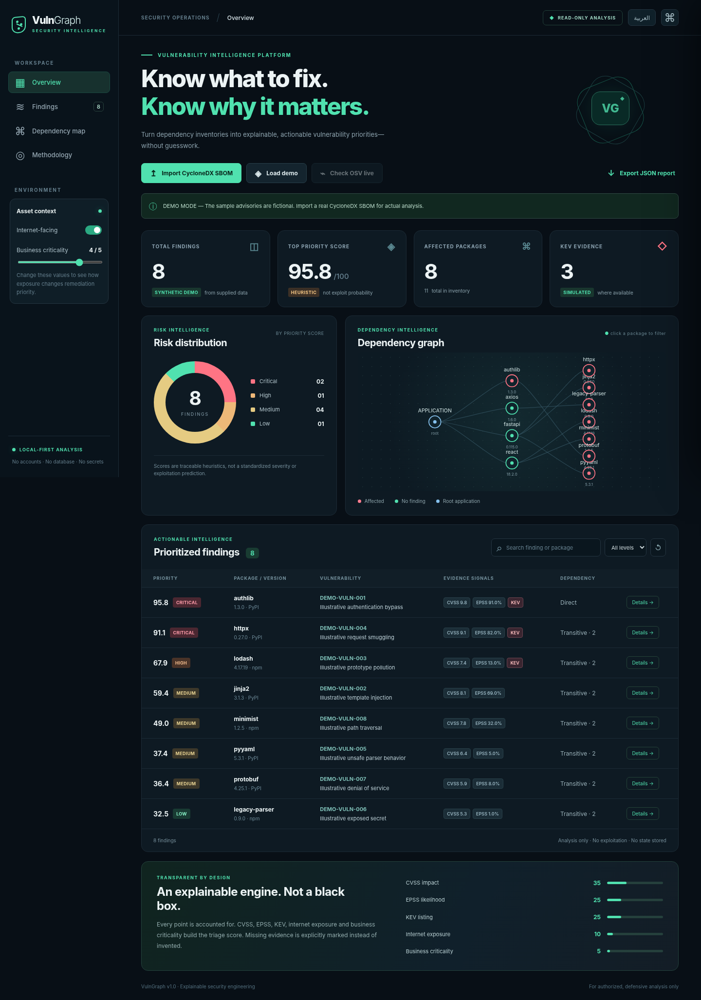
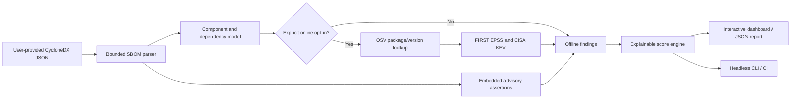

<div align="center">

# ◈ VulnGraph

### Vulnerability Intelligence for the Software Supply Chain

**Know what to fix. Know why it matters.**

A bilingual, explainable vulnerability-triage dashboard that turns **CycloneDX SBOMs** into ranked findings, dependency relationships, and an actionable remediation queue.

`Python 3.11+` · `FastAPI` · `CycloneDX` · `OSV` · `FIRST EPSS` · `CISA KEV` · `Docker` · `GitHub Actions`

</div>



**No-install interactive showcase:** open [`docs/index.html`](docs/index.html). It is a **static fictional demo** (no upload or online vulnerability checking); the full app requires the FastAPI backend. Publishing the `/docs` folder on GitHub Pages makes the showcase accessible to recruiters.

> [!IMPORTANT]
> **Demo advisories are fictional.** The shipped example is for demonstrating UI and methodology only: it is not a set of real vulnerabilities. Only a user-supplied SBOM can assert known vulnerabilities, or an **explicit** OSV lookup can retrieve public advisories. Neither result proves runtime reachability or exploitability.

## Why this project is different

**Not just another CVE list.** VulnGraph combines publicly available evidence with context the operator supplies. For each impacted package, it answers:

- **What is affected?** Correlates advisories to `bom-ref` components and preserves package versions.
- **Where does it live?** Maps direct and transitive dependencies from CycloneDX `dependencies`.
- **Why fix it first?** Provides a deterministic, inspectable score breakdown instead of unexplained percentages.
- **What is the next action?** Suggests maintainer-advisory review and safe upgrades, noting fixed versions only when supplied.
- **What evidence is missing?** Keeps unreported CVSS and EPSS fields *unknown*, rather than hallucinating them.
- **Can I automate it?** Yes: REST API, headless CLI, report export, Docker, and GitHub Actions.

### Feature overview

| Capability | Details |
| --- | --- |
| 📊 Risk overview | Distribution, highest triage score, affected packages, and KEV evidence |
| 🕸️ Dependency graph | Interactive package topology and direct/transitive classification, not an exploit path |
| 🔍 Vulnerability correlation | Reads SBOM assertions or performs opt-in OSV queries for versioned packages |
| 📈 Evidence enrichment | CVSS v3.0/v3.1 vectors, FIRST EPSS, CISA KEV when available |
| 🧮 Explainable prioritization | Factors, maximum contributions, absent inputs, dynamic business context |
| 🌐 Internationalization | Responsive English/Arabic dashboard with right-to-left layout |
| 📄 Reporting | JSON evidence report + remediation queue |
| 🛡️ Secure defaults | No credentials, local bind, no persistence, no target probing, bounded uploads |
| 🧪 Engineering | Automated integration/unit tests, multiple Python versions, container build |

## Architecture



### Windows quick start — double-click RUN.bat

If you used the non-ZIP source creator (`VulnGraph-Create-Source.ps1`), open its generated **`VulnGraph-Source`** folder in Visual Studio Code and run `RUN.bat`. The launcher sets up an isolated `.venv`, installs dependencies, and starts the full FastAPI dashboard at `http://127.0.0.1:8000`. Python 3.11+ is required. To stop the server, press Ctrl+C in the terminal window. The first dependency installation requires internet access.

### Quick start — no IDE required

Requirements: **Python 3.11+** and internet access only for the **initial dependency installation**.

```bash
# From this repository folder
python -m venv .venv
# Windows: .venv\Scripts\python.exe -m pip install -r requirements.txt
# Linux / macOS:
.venv/bin/python -m pip install -r requirements.txt
.venv/bin/python -m vulngraph.cli serve
```

Windows PowerShell, without activating the environment:

```powershell
py -m venv .venv
.\.venv\Scripts\python.exe -m pip install -r requirements.txt
.\.venv\Scripts\python.exe -m vulngraph.cli serve
```

Open **http://127.0.0.1:8000**. The dashboard initially loads a clearly identified fictional demo.

### Docker

```bash
docker compose up --build
```

Open `http://127.0.0.1:8000`. The container runs as a non-root user, with a read-only filesystem and dropped Linux capabilities. The Compose port is bound to localhost.

## Analyze a real SBOM

1. Generate or obtain an **authorized CycloneDX JSON** SBOM (versions **1.4–1.7**) with `bom-ref`, package versions and preferably Package URLs (`purl`).
2. In the dashboard select **Import CycloneDX SBOM**. This is an **offline** import: only assertions already embedded in the document are reported as findings.
3. Optionally select **Check OSV live**, and confirm that package names/versions may be transmitted to OSV (public EPSS/KEV data is queried when needed). No private source code is uploaded by VulnGraph.
4. Review the source and missing-evidence warnings. Adjust exposure and business criticality to see context-driven triage.
5. Export the JSON report and verify the candidate fixes with the maintainers' authoritative advisories.

**Important:** An SBOM with no `vulnerabilities` may show zero findings offline; this is **not** a clean bill of health. OSV advisories may lack CVSS/EPSS, and failure of a source does not establish safety.

### Headless CLI

```bash
# Analyze existing SBOM assertions without any external API call
python -m vulngraph.cli analyze my-bom.cdx.json -o report.json --internet-facing --criticality 4

# Explicitly opt into OSV + supporting public enrichment
python -m vulngraph.cli analyze my-bom.cdx.json -o report.json --online

# Run the included *fictional* demo fixture (output remains marked demo)
python -m vulngraph.cli analyze demo/demo-sbom.cdx.json -o demo-report.json
```

This makes it possible to incorporate triage into build pipelines without browser interaction. The CLI intentionally rejects live enrichment when run against the included fictional example.

## Scoring methodology

A **descriptive prioritization heuristic** (0–100), **not CVSS, EPSS, a validated machine learning score, or an exploitation probability**:

| Signal | Formula | Max points |
| --- | --- | ---: |
| CVSS v3 base | `CVSS × 3.5` | 35 |
| FIRST EPSS | `EPSS probability × 25` | 25 |
| CISA KEV present | `25 if listed, else 0` | 25 |
| Internet facing | `10 if user says yes, else 0` | 10 |
| Business criticality | `(criticality − 1) × 1.25`, levels 1–5 | 5 |
| **Total** | Sum, capped at 100 | **100** |

Classification: **Critical ≥ 80**, **High ≥ 60**, **Medium ≥ 35**, **Low below 35**. Missing CVSS and EPSS contribute zero *with a visible missing-evidence flag*; this may under-prioritize findings. Network status is manually set and never inferred.

CVSS v3 vector scores are calculated using the published v3 base formula. CVSS v4 is not parsed as v3. Package versions with no supported purl cannot be queried online. Direct vs transitive dependency is inferred from the SBOM graph, **not runtime reachability**.

## REST API

- `GET /api/health` — readiness and version.
- `GET /api/demo?internet_facing=true&business_criticality=4` — fictional sample.
- `POST /api/analyze` — accept `{ "sbom": { ... }, "mode": "offline|osv", "context": {"internet_facing": false, "business_criticality": 1} }`.
- `GET /api/docs` — interactive OpenAPI documentation.

See [API reference](docs/API.md) and [security model](docs/SECURITY.md).

## Testing

```bash
python -m pip install -r requirements-dev.txt
python -m pytest -q
python -m compileall -q vulngraph
node --check static/app.js       # optional: JavaScript syntax
```

GitHub Actions runs the tests on Python 3.11/3.12/3.13 and builds the Docker image. **Real network integration is not part of default CI**; OSV/FIRST/KEV are simulated in tests using a controlled mock transport.

## Privacy and scope

VulnGraph is a **defensive vulnerability intelligence / software-supply-chain** project. It does not run Nmap, probe targets, attempt exploitation, discover hidden vulnerabilities, or send code to third parties. Imported SBOMs remain in process memory while requests are handled. Opt-in online lookups transmit the specified package identifiers and versions to public data providers. No user accounts, telemetry, application database, or API tokens are required.

> Not intended as a publicly exposed multi-tenant SaaS without additional authentication, deployment hardening, rate limiting, tenancy separation and security review.

**Documentation:** [دليل النشر بالعربية](docs/PUBLISH_AR.md) · [الشرح التقني بالعربية](docs/EXPLANATION_AR.md) · [API](docs/API.md) · [Security](docs/SECURITY.md) · [Roadmap](docs/ROADMAP.md) · [Contributing](CONTRIBUTING.md).

## Attribution

Vulnerability lookup: [OSV](https://osv.dev/) · Exploitation probability: [FIRST EPSS](https://www.first.org/epss/) · Known exploited catalog: [CISA KEV](https://www.cisa.gov/known-exploited-vulnerabilities-catalog) · SBOM specification: [CycloneDX](https://cyclonedx.org/).

**License:** [MIT](LICENSE). Acknowledgment of third-party vulnerability information does not imply endorsement or verified accuracy.
